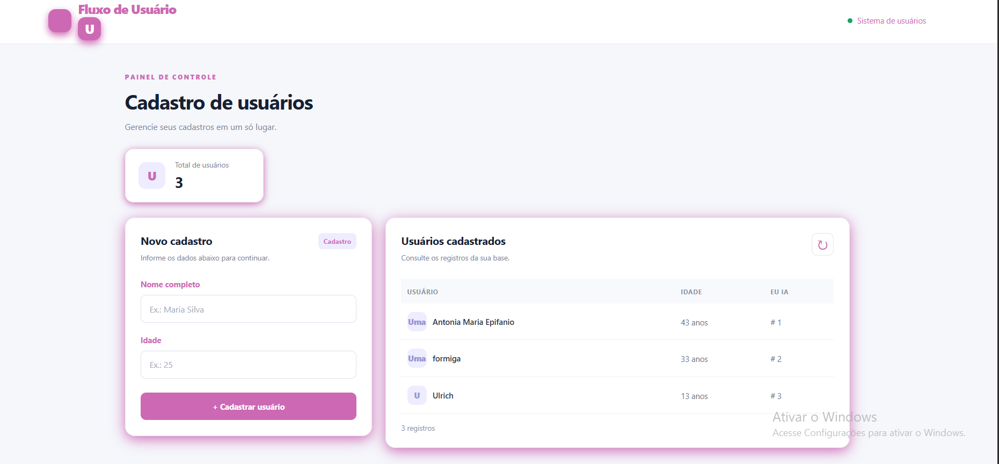

# Cadastro de Usuários

Aplicação web para cadastro e consulta de usuários, desenvolvida como projeto prático de estudos em desenvolvimento de software.

## Tecnologias utilizadas

### Backend
- Java 21
- Spring Boot
- Spring Data JPA
- Maven
- Banco de dados H2
- Docker

### Frontend
- React
- TypeScript
- CSS

  
## Demonstração




## Funcionalidades

- Cadastro de usuários com nome e idade.
- Consulta e listagem dos usuários cadastrados.
- Integração entre frontend e API REST.
- Persistência de dados utilizando H2.

## Estrutura do projeto

- `backend/`: API REST desenvolvida com Java e Spring Boot.
- `frontend/`: interface web desenvolvida com React e TypeScript.

## Como executar

### Backend

Abra a pasta `backend` em uma IDE compatível com Maven e execute a classe principal do Spring Boot.

API: `http://localhost:8080/api/v1/cadastrousuario`

### Frontend

Entre na pasta `frontend` e execute:

```bash
npm install
npm run dev
```

O Vite informará o endereço local para acessar a aplicação.

## Banco de dados

O projeto utiliza H2 em memória para desenvolvimento. Os dados são perdidos quando a aplicação backend é reiniciada.

## Objetivo

Praticar desenvolvimento de APIs REST, integração entre frontend e backend e tecnologias do ecossistema Java.

## Autora

Jamily Silva
